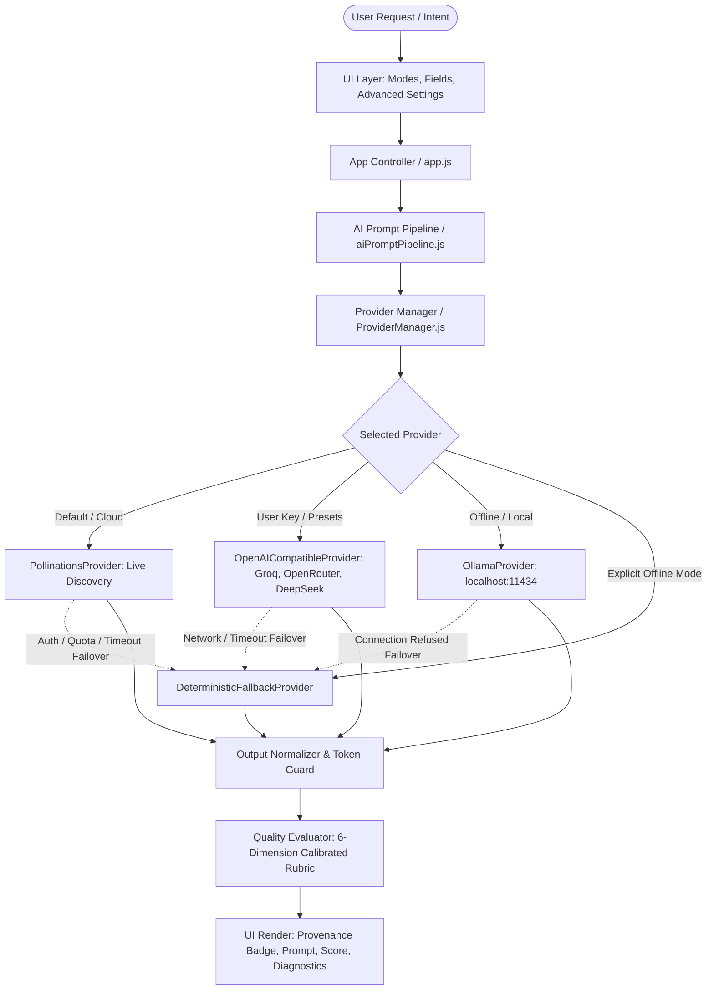

# Prompt Generator — Technical Architecture

This document details the architectural design, generation pipeline, provider abstraction, security boundaries, and evaluation mechanics of **Prompt Generator**.

---

## 1. Architectural Overview

Prompt Generator is structured as a client-centric, privacy-first web application and Chrome Extension that combines **real AI inference** (via Pollinations AI, OpenAI-compatible providers, or local Ollama) with a **resilient deterministic rule engine**.

---

## 2. Component Subsystems

### 2.1 AI Provider Subsystem (`js/ai/`)

The provider subsystem isolates external network communication from business logic. Every provider inherits from `BaseProvider`:

- **`BaseProvider.js`**: Defines the unified interface (`generateChat`, `listModels`, `testConnection`), handles timeout aborts (`AbortController`), and maps HTTP status codes into typed error classes:
  - `ProviderAuthError` (401/403): Missing or invalid credentials.
  - `ProviderQuotaError` (402/429): Quota exhausted or rate limited.
  - `ProviderTimeoutError`: Abort triggered after configured timeout limit.
  - `ProviderNetworkError`: DNS, offline, or CORS failure.
  - `ProviderModelError`: Specified model not recognized or not available.

- **`PollinationsProvider.js`**: Integrates with the official Pollinations AI platform (`https://gen.pollinations.ai`).
  - Dynamic discovery via `GET https://gen.pollinations.ai/models`.
  - Filters models strictly by text modality (`type === "chat"` or `type === "text"`).
  - Inspects model health indicators (`censored: false`, operational status).
  - Caches model catalogs in `localStorage` for 1 hour to prevent redundant requests.
  - Handles authenticated calls (with user API key) and gracefully catches HTTP 401 anonymous quota exhaustion.

- **`OpenAICompatibleProvider.js`**: Connects to standard OpenAI-compatible endpoints with vendor presets:
  - **Groq** (`https://api.groq.com/openai/v1`): Ultra-fast inference with free tier limits.
  - **OpenRouter** (`https://openrouter.ai/api/v1`): Aggregated open-weight models (`meta-llama/llama-3-8b-instruct:free`, etc.).
  - **DeepSeek** (`https://api.deepseek.com/v1`): DeepSeek-V3 / DeepSeek-R1.
  - **Custom BaseURL**: Any endpoint supporting `/v1/chat/completions`.

- **`OllamaProvider.js`**: Connects to a locally running Ollama instance (`http://localhost:11434/v1`).
  - Fetches installed models via `/api/tags`.
  - Zero external traffic; all prompt generation remains completely on the user's hardware.

- **`DeterministicFallbackProvider.js`**: An offline synthesized rule engine.
  - Activated when offline or when external AI inference encounters transient failure.
  - Generates structured, task-specific prompts tailored to the task category without inserting unhelpful bracketed placeholders (`[Insert audience here]`).
  - Returns metadata explicitly marking output as `isAiGenerated: false` and `isFallback: true`.

- **`ProviderManager.js`**: Manages user configuration, persistent storage in `localStorage`, event-driven UI updates, and automated failover routing.

---

## 3. The AI Generation Pipeline (`js/engine/aiPromptPipeline.js`)

Unlike simple template wrappers that prepend `"Act as an expert"`, the pipeline executes a multi-stage prompt engineering workflow:

1. **Intent & Domain Classification**: Analyzes task description, category, and parameters to establish context.
2. **Context Assembly**: Gathers objective, domain constraints, output specifications, target audience, and environment details.
3. **Platform Adaptation**: Automatically tailors instruction framing to target model platforms:
   - *ChatGPT*: Markdown hierarchy and step-by-step reasoning instructions.
   - *Claude*: Artifact framing and XML tag delineation (`<context>`, `<requirements>`, `<deliverables>`).
   - *Gemini*: Structured schemas and multimodal input anchoring.
   - *DeepSeek*: Chain-of-thought instructions and architectural verification.
   - *Midjourney*: Comma-separated aesthetic parameters, lighting tags, aspect ratios (`--ar 16:9`), and negative constraints (`--no text`).
   - *Cursor*: Concise file-level instructions and unit test directives.
4. **Mode Calibration**: Adjusts structural depth across 7 distinct modes:
   - `quick`: Crisp, actionable directive.
   - `detailed`: Comprehensive task instructions, contextual parameters, and expected format.
   - `professional`: Enterprise-grade specification with deliverables, quality standards, and guardrails.
   - `expert`: Multi-stage architectural breakdown with quality gates and verification checklist.
   - `improve`: Analyzes user's existing prompt, diagnoses weak points, and synthesizes an upgraded version.
   - `alternatives`: Generates 3 structurally distinct approaches (Strategic, Technical, Minimalist).
   - `evaluate`: Diagnostic report assessing prompt quality across 6 calibrated dimensions.
5. **Bilingual Token Guarding**: When generating in Arabic (`ar`), Latin technical identifiers (e.g. `Vue.js`, `REST API`, `Docker`, code snippets) are guarded with directional isolation (`dir="ltr"` or code formatting) to prevent bi-directional layout corruption.
6. **Output Normalization**: Strips conversational preambles (e.g., *"Here is your generated prompt:"*) and closing pleasantries, returning strictly the production-ready prompt text.

---

## 4. Prompt Quality Evaluator (`js/engine/qualityEvaluator.js`)

The evaluator uses a calibrated, multi-dimensional scoring rubric (0–100%):

| Dimension | Weight | Criteria Evaluated |
| :--- | :---: | :--- |
| **Objective Clarity** | 20% | Explicit action verb or clear visual subject definition. |
| **Context Sufficiency** | 15% | Background information, domain environment, or narrative scene. |
| **Specificity & Inputs** | 20% | Concrete metrics, parameters, technical stacks, or composition tags. |
| **Constraints & Exclusions** | 15% | Explicit negative constraints, boundaries, or what *not* to do. |
| **Output Structure** | 15% | Format specification (JSON, markdown, table, bulleted list). |
| **Testability & Quality** | 15% | Acceptance criteria, edge cases, unit tests, or rendering standards. |

### Domain Calibration
- **Visual Domains (Image / Video)**: Testability checks for aesthetic parameters (lighting, composition, aspect ratios) rather than coding unit tests.
- **Anti-Pattern Penalties**: Prompts containing unfulfilled placeholder brackets (e.g. `[Specify database]`, `[Insert here]`) are penalized up to 25 points, preventing superficial template output from receiving high scores.

---

## 5. Security Architecture & Boundaries

1. **Client-Side Key Storage**:
   - User-supplied API keys (for Groq, OpenRouter, Pollinations, or OpenAI) are stored strictly in browser `localStorage`.
   - Keys are never logged to analytics, never sent to external servers, and never transmitted to third parties.
2. **Direct Browser-to-Provider Communication**:
   - The frontend communicates directly with provider endpoints over HTTPS using `fetch()`.
   - There is no intermediary proxy server or backend database that could intercept credentials.
3. **Safe Fallback Guarantees**:
   - If an API key is rejected (HTTP 401/403) or quota is exhausted (HTTP 429), the error is surfaced clearly with a one-click fallback to offline deterministic generation.
   - Secrets are scrubbed from error logs before display to the user.

---

## 6. Data Persistence

- Application state (saved prompts, generation history, selected provider, active model, custom API keys) is persisted using the browser's standard Web Storage API (`localStorage`).
- Users can clear history, remove saved API keys, or export their prompts to JSON, Markdown, or plain text at any time.
