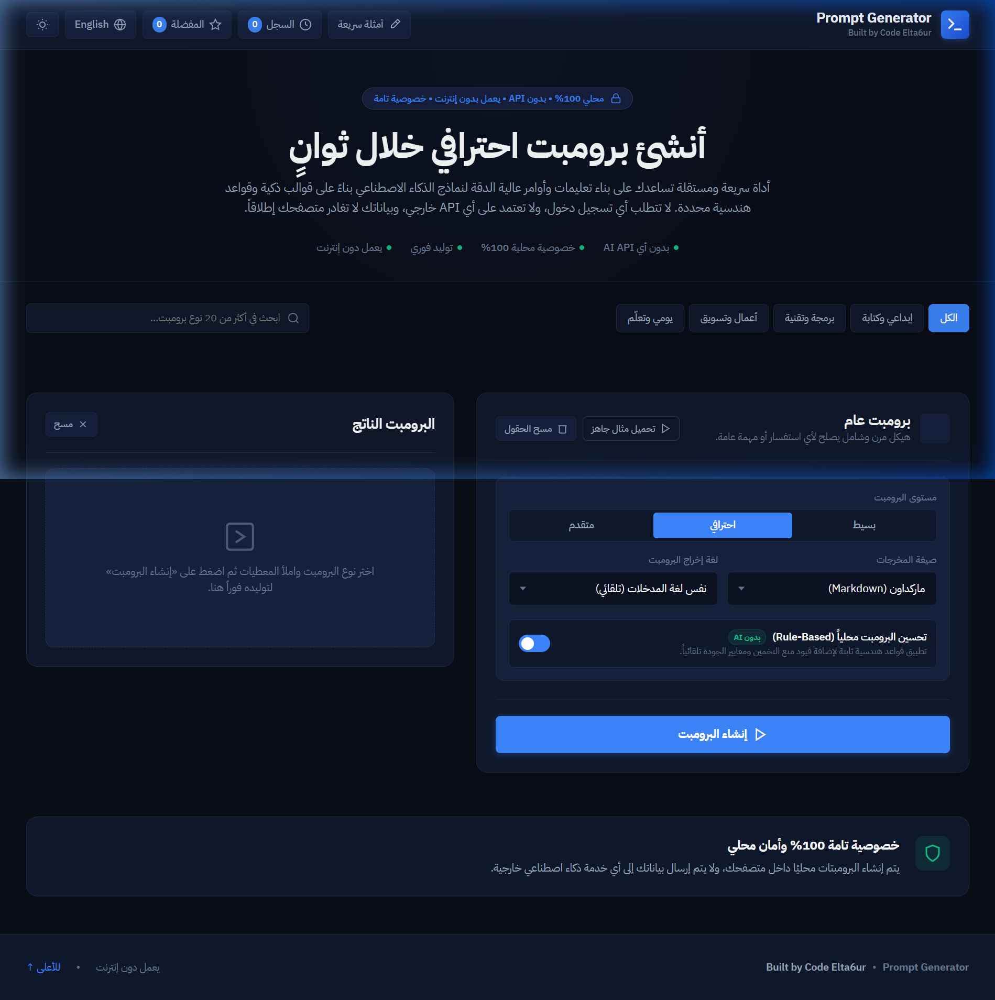

# Prompt Generator

<div align="center">



**A professional AI-powered prompt engineering workspace and companion Chrome Extension. Transforms vague ideas into precise, structured, model-adapted prompts using real AI model inference, multi-provider abstraction, dynamic model discovery, and calibrated quality diagnostics.**

*بيئة عمل متقدمة لهندسة وصناعة البرومبتات المدعومة بالذكاء الاصطناعي الحقيقي وإضافة Chrome متكاملة — لتحويل الأفكار والطلبات البسيطة إلى برومبتات احترافية، دقيقة، ومتوافقة مع مختلف النماذج، مع نظام تقييم موضوعي ومحرك احتياطي محلي 100%.*

[](LICENSE)
[](extension/manifest.json)
[](ARCHITECTURE.md)
[-brightgreen.svg)](tests/runner.js)
[](js/ai/DeterministicFallbackProvider.js)
[](https://github.com/mokashreef)

[🌐 Live Demo](https://mokashreef.github.io/Prompt-Generator/) • [🧩 Chrome Extension](#chrome-extension) • [📖 Architecture](ARCHITECTURE.md) • [📖 العربية](#نظرة-عامة-باللغة-العربية) • [💻 Local Setup](#installation--local-development)

<p align="center" style="margin-top: 1rem;">
  <a href="https://raw.githubusercontent.com/mokashreef/Prompt-Generator/main/prompt-generator-extension.zip" download="prompt-generator-extension.zip">
    
  </a>
</p>

</div>

---

## 📋 Table of Contents / جدول المحتويات

- [Why Rebuild Prompt Generator?](#why-rebuild-prompt-generator)
- [نظرة عامة باللغة العربية](#نظرة-عامة-باللغة-العربية)
- [Core Capabilities](#core-capabilities)
- [AI Provider Architecture & Dynamic Discovery](#ai-provider-architecture--dynamic-discovery)
- [Transparent Provenance Guarantee](#transparent-provenance-guarantee)
- [7 Distinct Generation Modes](#7-distinct-generation-modes)
- [Target Platform Adaptation](#target-platform-adaptation)
- [Calibrated Quality Evaluator](#calibrated-quality-evaluator)
- [14 Tailored Task Profiles](#14-tailored-task-profiles)
- [Chrome Extension (Manifest V3)](#chrome-extension)
- [Security & Privacy Boundaries](#security--privacy-boundaries)
- [Testing & Quality Assurance](#testing--quality-assurance)
- [Installation & Local Development](#installation--local-development)
- [Deployment](#deployment)
- [Contributing](#contributing)
- [License](#license)

---

## 💡 Why Rebuild Prompt Generator?

Early versions of Prompt Generator relied exclusively on static string concatenation templates. When a user submitted a request like `"build a website"`, the generator would output fixed boilerplate containing literal placeholders such as `[Insert Target Audience]` and `[Specify Database]`, giving an identical ~560-character output and a hardcoded 80% quality score regardless of the task domain.

**The Rebuilt Prompt Generator solves this fundamentally:**

| Dimension | Previous Implementation | Rebuilt Architecture |
| :--- | :--- | :--- |
| **Inference Engine** | Fixed string templates & bracketed placeholders | **Real AI model inference** via Pollinations, Groq, OpenRouter, or Ollama |
| **Failover Safety** | None (silent failure or crash) | **Automated graceful fallback** to an offline deterministic synthesis engine |
| **Output Provenance** | Unclear origin | **Explicit badge** indicating Real AI (`provider + model`) vs Deterministic Fallback |
| **Generation Modes** | Single fixed structure | **7 dedicated modes** (Quick, Detailed, Professional, Expert, Improve, Alternatives, Evaluate) |
| **Target Platforms** | Generic text | **Model-tailored syntax** (Markdown for ChatGPT, XML tags for Claude, JSON for Gemini, parameters for Midjourney) |
| **Quality Evaluation** | Hardcoded ~80% score | **Calibrated 6-dimension rubric** (0–100%) with domain sensitivity & anti-pattern penalties |
| **Domain Coverage** | 10 basic categories | **14 specialized task profiles** with domain-specific inputs & constraints |
| **Credential Security** | N/A | **Zero-server architecture**: user keys stored strictly in client `localStorage` |

---

## 🌍 نظرة عامة باللغة العربية

**Prompt Generator** هو تطبيق ويب متطور ومستقل، مدعوم بإضافة متصفح Chrome متكاملة (Manifest V3)، يهدف إلى تحويل الأوامر والأفكار البسيطة أو المقتضبة إلى برومبتات مهندسة بدقة فائقة عبر **استدلال الذكاء الاصطناعي الفعلي (Real AI Inference)**.

### الركائز الأساسية للنظام المُعاد بناؤه:
1. **استدلال حقيقي بالذكاء الاصطناعي:** يتصل النظام بنماذج ذكاء اصطناعي رائدة عبر مزودات متعددة (Pollinations AI، واجهات OpenAI المتوافقة مثل Groq وOpenRouter، وخوادم Ollama المحلية).
2. **محرك احتياطي ذكي ومحلي (Fail-Safe Deterministic Fallback):** في حال انقطاع الاتصال أو نفاد الحصص المجانية، يتحول النظام تلقائياً إلى محرك محلي اصطناعي يُنتج برومبتات متخصصة ومبنية على قواعد هندسة البرومبتات دون ترك فراغات ساذجة (`[حدد التقنية]`).
3. **شفافية تامة لمصدر التوليد (Provenance Guarantee):** لا ندعي أبداً أن مخرجات القوالب أو المحرك الاحتياطي هي ذكاء اصطناعي؛ حيث يظهر وسم واضح يُبين ما إذا كان البرومبت ناتجاً عن نموذج ذكاء اصطناعي (مع ذكر المزود واسم النموذج) أو عن المحرك الاحتياطي.
4. **7 أنماط توليد مختلفة:** من البرومبت السريع المباشر، إلى البرومبت المفصل، البرومبت الاحترافي، وضع الخبير والأنظمة المعقدة، وضع تحسين البرومبتات، توليد 3 بدائل إستراتيجية، والتقييم التشخيصي.
5. **خصوصية وأمان 100%:** جميع المفاتيح والبيانات تُحفظ حصرياً داخل متصفح المستخدم (`localStorage`) ولا تمر بأي خادم وسيط.

---

## ⚡ Core Capabilities

- **🧠 Real AI Generation Pipeline:** Analyzes the core objective, detects implicit requirements, frames contextual instructions, and produces production-grade prompts.
- **🔌 Multi-Provider Abstraction:** Seamless switching between Pollinations AI, OpenAI-compatible APIs (Groq, OpenRouter, DeepSeek, OpenAI), and local Ollama instances.
- **📡 Dynamic Model Discovery:** Automatically queries supported provider discovery endpoints, filters by text modality, checks health metrics, and populates selectable models dynamically.
- **⚖️ Calibrated Quality Evaluator:** Assesses prompts across 6 weighted dimensions (Objective, Context, Specificity, Constraints, Format, Testability) with domain-specific criteria and anti-pattern penalties.
- **🔄 3 Structural Alternatives:** Generates 3 fundamentally distinct prompt strategies (e.g., Strategic, Technical, and Minimalist) for the same core idea.
- **🪄 Improve Existing Prompts:** Takes raw user prompts, diagnoses structural gaps, and outputs an upgraded, battle-tested version.
- **🌐 Bilingual Precision:** Native support for Arabic (RTL) and English (LTR), preserving Latin code tokens, technical identifiers, and markdown formatting.
- **💾 Local History & Bookmarks:** Save, search, filter, and export prompts (TXT, Markdown, JSON) without requiring an account or cloud database.

---

## 🔌 AI Provider Architecture & Dynamic Discovery

Prompt Generator implements an extensible provider interface (`BaseProvider`) supporting four operational modes:

```
+-------------------------------------------------------------------------+
|                           ProviderManager                               |
+-------------------+-------------------+-----------------+---------------+
| PollinationsAI    | OpenAICompatible  | OllamaProvider  | Deterministic |
| (Cloud / Free IP) | (Groq/OpenRouter) | (Local Offline) | (Rule Engine) |
+-------------------+-------------------+-----------------+---------------+
```

1. **Pollinations AI (`PollinationsProvider`)**:
   - Official API: `https://gen.pollinations.ai/v1/chat/completions`.
   - Dynamic catalog fetched from `https://gen.pollinations.ai/models`.
   - Modality filtering ensures only text/chat models are presented (excluding image-only models).
   - Models cached in `localStorage` for 1 hour to prevent excessive traffic.
   - Transparently catches HTTP 401 anonymous quota exhaustion and triggers fallback.
2. **OpenAI-Compatible (`OpenAICompatibleProvider`)**:
   - Supports **Groq** (`api.groq.com/openai/v1`) with free high-throughput LLaMA models.
   - Supports **OpenRouter** (`openrouter.ai/api/v1`) with free community open-weight models.
   - Supports **DeepSeek** (`api.deepseek.com/v1`) and official OpenAI endpoints.
3. **Local Ollama (`OllamaProvider`)**:
   - Discovers installed local models via `http://localhost:11434/api/tags`.
   - 100% private and offline execution on the user's local hardware.
4. **Deterministic Fallback (`DeterministicFallbackProvider`)**:
   - Rule-based offline synthesis engine.
   - Eliminates useless bracketed templates, producing structurally rich prompts tailored to the task category.

---

## 🏷️ Transparent Provenance Guarantee

We uphold strict engineering integrity: **a template or rule-based output is NEVER labeled as AI-generated.**

Every generated prompt displays an unambiguous provenance badge in the UI:
- 🟢 **Real AI**: Displays `Provider: Pollinations AI • Model: openai` (or Groq, Ollama, etc.).
- 🟡 **Deterministic Fallback**: Displays `Mode: Deterministic Fallback • Offline Rule Engine`.

---

## 🎯 7 Distinct Generation Modes

| Mode | Objective | Output Character & Depth |
| :--- | :--- | :--- |
| **Quick Prompt** | Concise, actionable directive for rapid execution | Crisp task instruction with immediate input variables. |
| **Detailed Prompt** | Thorough prompt with context, constraints, and format | Full operational framing, role definition, and output schema. |
| **Professional** | Enterprise specification with quality criteria | Structured with deliverables, edge cases, and compliance standards. |
| **Expert / Complex** | Multi-phase architecture for large engineering tasks | Phased execution pipeline, verification milestones, and quality gates. |
| **Improve Existing** | Refactor and elevate a raw user prompt | Diagnoses weaknesses and produces an optimized rewrite. |
| **Generate Alternatives** | 3 distinct structural perspectives on one goal | Strategic, Technical, and Minimalist prompt variants. |
| **Prompt Evaluation** | In-depth diagnostic score and improvement advice | Calibrated 6-dimension rubric with identified strengths and gaps. |

---

## 📐 Target Platform Adaptation

The generation pipeline automatically adapts prompt syntax to the selected target AI:
- **ChatGPT**: Hierarchical Markdown with clear section dividers and step-by-step instructions.
- **Claude**: XML tag delineation (`<context>`, `<task>`, `<constraints>`, `<deliverables>`) for optimal Sonnet/Opus comprehension.
- **Gemini**: Strongly-typed structured schemas, grounding cues, and multimodal context slots.
- **DeepSeek**: Architectural chain-of-thought directives and rigorous verification constraints.
- **Midjourney**: Comma-separated visual styling tags, lighting, composition ratios (`--ar 16:9`), and negative exclusions (`--no blur`).
- **Cursor**: Concise file-level implementation instructions and unit testing rules.

---

## 📊 Calibrated Quality Evaluator

The quality evaluator scores prompts from **0 to 100%** using a calibrated, task-aware rubric:

```
Total Score (100%) = 
  Objective Clarity (20%) + Context Sufficiency (15%) + Specificity (20%)
  + Constraints (15%) + Output Format (15%) + Testability & Quality (15%)
  - Anti-Pattern Penalties (up to -25% for unfulfilled bracket placeholders)
```

- **Domain-Specific Criteria**: An image generation prompt is evaluated on lighting, visual composition, and rendering style rather than unit testing or database constraints.
- **Actionable Diagnostics**: Returns itemized strengths, weaknesses, missing information, and concrete suggestions for immediate improvement.

---

## 🧱 14 Tailored Task Profiles

Each profile specifies dedicated fields, domain constraints, and structure:

1. **General / Adaptive** — Universal intent-driven framing.
2. **Software Development** — Architecture, tech stack, error handling, and API specs.
3. **Debugging & Code Review** — Bug reproduction, root-cause isolation, and unit test fixes.
4. **Architecture & System Design** — Non-functional requirements, scaling, and trade-off matrices.
5. **Writing & Content** — Tone, audience persona, narrative structure, and SEO keywords.
6. **Marketing & Conversion** — Customer avatar, value proposition, and CTA hooks.
7. **Research & Analysis** — Methodology, scholarly rigor, citations, and critical counterarguments.
8. **Business Strategy** — P&L impact, risk assessment, and operational roadmaps.
9. **Education & Tutoring** — Pedagogy, progressive disclosure, and interactive knowledge checks.
10. **Data Analysis** — Statistical distributions, anomaly detection, and visualization schemas.
11. **Image Generation** — Midjourney/SD visual styles, lighting, camera angles, and aspect ratios.
12. **Video Generation** — Pacing, storyboards, camera motion, and audio cues.
13. **Automation & Workflows** — Trigger events, API webhooks, edge-case retries, and rate limits.
14. **Translation & Localization** — Cultural nuance, tone adaptation, and glossary enforcement.

---

## 🧩 Chrome Extension (Manifest V3)

The project includes a companion Manifest V3 browser extension sharing the core engine:
- **In-Page Text Replacement**: Works inside textareas, inputs, and rich-text editors (ChatGPT, Claude, Gemini, Notion).
- **Side Panel & Popup**: Complete prompt engineering workspace accessible from any browser tab.
- **Visual Diff Viewer**: Side-by-side visual diff highlighting additions and modifications.
- **Direct ZIP Package**: Built and packaged in the repository for one-click download.

---

## 🔒 Security & Privacy Boundaries

- **Zero-Server Architecture**: The application is 100% static client-side JavaScript. There is no intermediary backend database or logging server.
- **Local Key Storage**: API keys entered into the AI Settings modal are stored strictly in `window.localStorage` and used directly in HTTPS fetch requests to the designated provider.
- **No Secret Commits**: `.env.example` documents setup without including secrets. Automated tests and builds contain zero hardcoded credentials.

---

## 🧪 Testing & Quality Assurance

Prompt Generator includes a comprehensive automated test suite covering all functional and architectural requirements:

```bash
# Run the complete test suite
npm test
```

### Verified Test Suites:
1. **AI Providers & Failover (`tests/providers.test.js`)**: 27 passing tests covering typed error hierarchies, dynamic model discovery, modality filtering, custom OpenAI-compatible endpoints, Ollama daemon communication, and automated fallback.
2. **AI Pipeline & Generation Modes (`tests/pipeline.test.js`)**: 36 passing tests verifying all 7 generation modes, target platform adaptations, Arabic token preservation, and conversational filler stripping.
3. **Quality Evaluator & Rubric (`tests/evaluator.test.js`)**: 9 passing tests validating multi-dimensional scoring weights, placeholder penalties, and domain calibration (visual vs code).
4. **Quality Benchmark Suite (`tests/quality_suite.test.js`)**: 15 passing tests running realistic, diverse tasks across 6 distinct domains (software development, debugging, marketing, cinematic image generation, strategic research, data analysis) and verifying structural dissimilarity.
5. **Legacy Baseline Regression (`tests/engine.test.js`)**: Backward-compatibility regression suite.

**Test Results: 100% PASSING across all 5 suites.**

---

## 💻 Installation & Local Development

### Prerequisites
- Node.js 18+ (optional, for local development server and test runner)
- Modern web browser (Chrome, Edge, Firefox, Brave, Safari)

### Setup Instructions

```bash
# Clone the repository
git clone https://github.com/mokashreef/Prompt-Generator.git
cd Prompt-Generator

# Checkout the rebuild branch
git checkout rebuild/ai-prompt-generator

# Run automated tests
npm test

# Start local development server
npm run dev
# Application will be accessible at http://localhost:8080
```

---

## 🚀 Deployment

The project can be deployed instantly to any static hosting service:
- **GitHub Pages**: Automatically deployed from `main` or `docs/`.
- **Vercel / Netlify / Cloudflare Pages**: Deploy with zero build step (serve root directory).

---

## 🤝 Contributing

Contributions are warmly welcomed! Please read our [ARCHITECTURE.md](ARCHITECTURE.md) to understand provider interfaces and generation pipelines before submitting Pull Requests.

1. Fork the repository.
2. Create your feature branch (`git checkout -b feat/my-new-feature`).
3. Commit your changes following conventional commits (`git commit -m 'feat: add Claude 3.7 Sonnet preset'`).
4. Run `npm test` to verify all tests pass.
5. Push to the branch (`git push origin feat/my-new-feature`).
6. Open a Pull Request.

---

## 📄 License

Distributed under the **MIT License**. See [LICENSE](LICENSE) for more information.

---

## 👨‍💻 Developer & Attribution

Developed by **[Mohammad Abu Khashreef](https://github.com/mokashreef)**. Part of the **Code Elta6ur** ecosystem.
